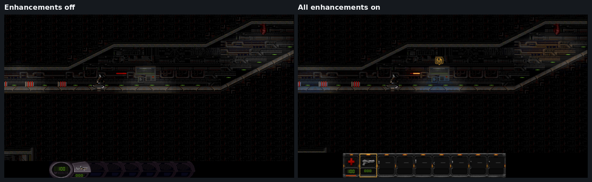

# Abuse Modern

A modern source port of Abuse 0.8 with SDL3, CMake, readable menus,
key rebinding, a new HUD and dual-stick gamepad support. Original gameplay and maps are retained.



Builds and tests on **Linux and macOS**. Windows is not currently supported.

## Build

Requires a C++17 compiler, CMake 3.24+, Git and pkg-config. The setup script
supports apt, dnf, pacman, zypper and Homebrew:

```sh
./scripts/setup.sh --plan --music       # preview dependencies
./scripts/setup.sh --install --music    # install dependencies
./scripts/setup.sh --check
cmake -S . -B build -DCMAKE_BUILD_TYPE=Release
cmake --build build --parallel
```

CMake downloads pinned SDL3/SDL3_mixer sources if suitable versions are not installed.
The first configure needs internet access. On macOS, install Apple command-line
tools first: `xcode-select --install`.

## Run

Download the assets from [Abuse downloads](http://abuse.zoy.org/wiki/download)
and extract them separately. Use the directory containing `abuse.lsp`:

```sh
./build/abuse -datadir /path/to/data
```

A local `data/` folder is ignored by Git. Useful options: `-fullscreen`,
`-windowed`, `-nosound`, `-edit`, `-scale 1` through `-scale 8`, and `--help`.

**Music:** Ubuntu/Debian needs `sudo apt install freepats` (included by the
setup script's `--music` option). Elsewhere, install TiMidity-compatible `.pat`
instruments and set `TIMIDITY_CFG=/path/to/freepats.cfg`. SoundFont-only `.sf2`
files are insufficient; sound effects work without music patches.

## Controls

**Keyboard/mouse:** WASD moves/jumps/uses, mouse aims, left click fires,
right click uses the special action, and the wheel changes weapons.
**Settings → Mouse wheel** enables/disables weapon cycling; menu scrolling stays
available. Wheel controls follow your saved Previous/Next weapon bindings.
Escape pauses/returns; F11 toggles fullscreen; F12 toggles mouse grab.
Change bindings under **Settings → Key bindings**.

**Gamepad:** requires two sticks. Devices missing either stick show a warning
and have gameplay input disabled; menu navigation still works.

| Input | Action |
| --- | --- |
| Left stick / D-pad | Move |
| Right stick | Aim |
| Right trigger | Fire |
| South (A / Cross) | Jump / confirm |
| East (B / Circle) | Use, crouch / cancel |
| Left trigger / West | Special action |
| Bumpers | Change weapons / menu pages |
| Start | Pause / back |

Adjust the dead zone under **Settings → Controller**. Network text fields need
a keyboard. Saving uses the original in-level save consoles.

Bindings, controller settings, volumes, difficulty, view resolution and window scale
persist. **Settings → Display mode** switches between windowed and native desktop
fullscreen. **View resolution** changes immediately: 320×200 (original), 480×300,
640×400 or widescreen 640×360. Larger views show more of the level with smaller
characters. **Window scale** changes window size. Under **Settings → Enhancements**, toggle
**Modern HUD**, **Enhanced Lighting**, **Enhanced projectiles**, and **Checkpoint Feedback**.
These are on by default. Checkpoint Feedback marks nearby save consoles and
confirms a successful save. Enhanced projectiles adds tapered beams and short
weapon trails.
**Smooth pixels** applies an optional 2× edge-aware filter to the displayed frame.
It takes effect immediately, is saved, and defaults to off. Gameplay interpolates
camera and object motion at up to 60 frames per second.
Enhanced Lighting gives round lights a warm tint and directional lights a cool
tint. It smooths light falloff and adds colored flashes, sparks and
smoke to explosions that use the game's flash effect. Lasers, plasma and rockets
cast subtle reflections on nearby walls as they travel. Launches start in native
fullscreen; use `-windowed` to start windowed. New configurations use a 480×300
view. Use `-view 640x360` for a temporary override.
Command-line options override saved settings for that launch. Saves/settings normally live in
`~/.local/share/abuse-modern/abuse-modern/` on Linux. Override with `ABUSE_SAVE_PATH`.

## Art tools

Run `python3 scripts/tile_browser.py /path/to/data` to build
`build/tile-browser.html`. Open it in a browser to inspect original tiles and
their campaign usage, or select a suggested art batch. **Show in level**
highlights a tile among its neighbors in sampled placements. The report stays local.

## Tests

```sh
ctest --test-dir build --output-on-failure
```

CI checks Linux (GCC/Clang) and macOS without game assets. For additional
save/load, menu, controller-warning and intro-music tests:

```sh
cmake -S . -B build \
  -DABUSE_TEST_ASSET_DIR=/path/to/data \
  -DABUSE_TEST_TIMIDITY_CFG=/path/to/freepats.cfg
cmake --build build --parallel
ctest --test-dir build --output-on-failure
```

Engine integration tests run on Linux with isolated saves and a dummy display.

## License

**GPL-2.0-or-later.** See [LICENSE](LICENSE) for terms and original credits.
Game assets, instrument patches and dependencies retain their separate licenses.
