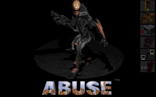
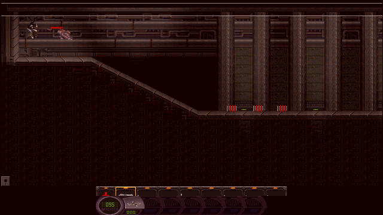
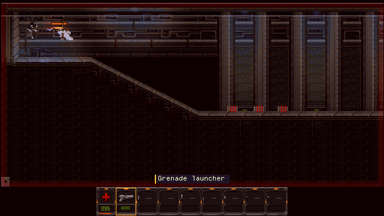
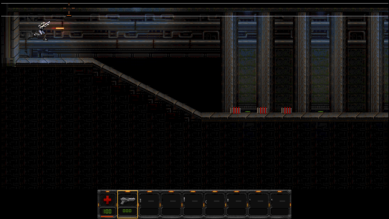
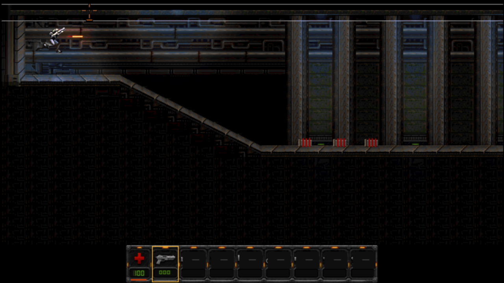

# Abuse Modern

An SDL3 port of Abuse 0.8 with upgraded graphics, widescreen play, redesigned menus, and dual-stick gamepad support.

[Download Abuse Modern](https://github.com/karapant/abuse-modern/releases/latest) · [Project website](https://karapant.github.io/abuse-modern/)

## Install and play

- **Windows x64** — Run the setup `.exe`, then open **Abuse Modern** from the Start menu.
- **Linux x64** — Extract the `.tar.gz` and run `./play` from the extracted folder.
- **macOS** — Open the Apple Silicon or Intel `.dmg` for your Mac, then run **Play Abuse Modern.command**.

On first launch, download the Abuse 0.8 game data through the launcher or import an archive or folder you already have.

Use **WASD** to move, the **mouse** to aim, and **left click** to fire. Press **1–8** to select a weapon directly, **Q** to swap to your last weapon, and **Esc** to pause. Change bindings and controller settings under **Settings**.

## Before and after

### Main menu

| Before · Abuse 0.8 | After · Abuse Modern |
| --- | --- |
|  |  |

### In-game graphics

The same scene with enhancements off (left) and on (right), showing the redesigned HUD and projectile lighting in an earlier build.


### Combat feedback, smart crosshair & weapon swap

| Before · Classic feedback | After · Combat feedback & smart crosshair |
| --- | --- |
|  |  |

### Pixel filter

| Crisp pixels (default) | Smooth pixels (optional) |
| --- | --- |
|  |  |

Save consoles now light up as you approach. [See the checkpoint glow](site/screenshots/checkpoint-glow.png).

Toggle all upgrades under **Settings → Enhancements**: **Modern HUD**, **Enhanced Lighting**, **Checkpoint Feedback**, **Smooth pixels**, **Enhanced projectiles**, **Directional sound cues**, **Combat feedback** (reticle hit-markers, enemy hit-flashes, target health bars, and a damage/low-health edge vignette), and **Smart crosshair** (fire-pulse reticle, target-hover highlight, and low/empty ammo cues). Abuse Modern also adds smoother 60fps camera/object motion and **1–8** / **Q** quick weapon switching.

## Build from source

Use CMake 3.24+, Git, and a C++17 compiler. On Linux and macOS, run `./scripts/setup.sh --install` to install dependencies. On Windows, build from the MSYS2 UCRT64 shell with MinGW-w64 GCC, CMake, Ninja, and pkgconf.

```sh
cmake -S . -B build -G Ninja -DCMAKE_BUILD_TYPE=Release
cmake --build build --parallel
./build/abuse -datadir "/path/to/folder-containing-abuse.lsp"
```

[GPL-2.0-or-later](LICENSE) for the engine. Game data retains its original licensing.
